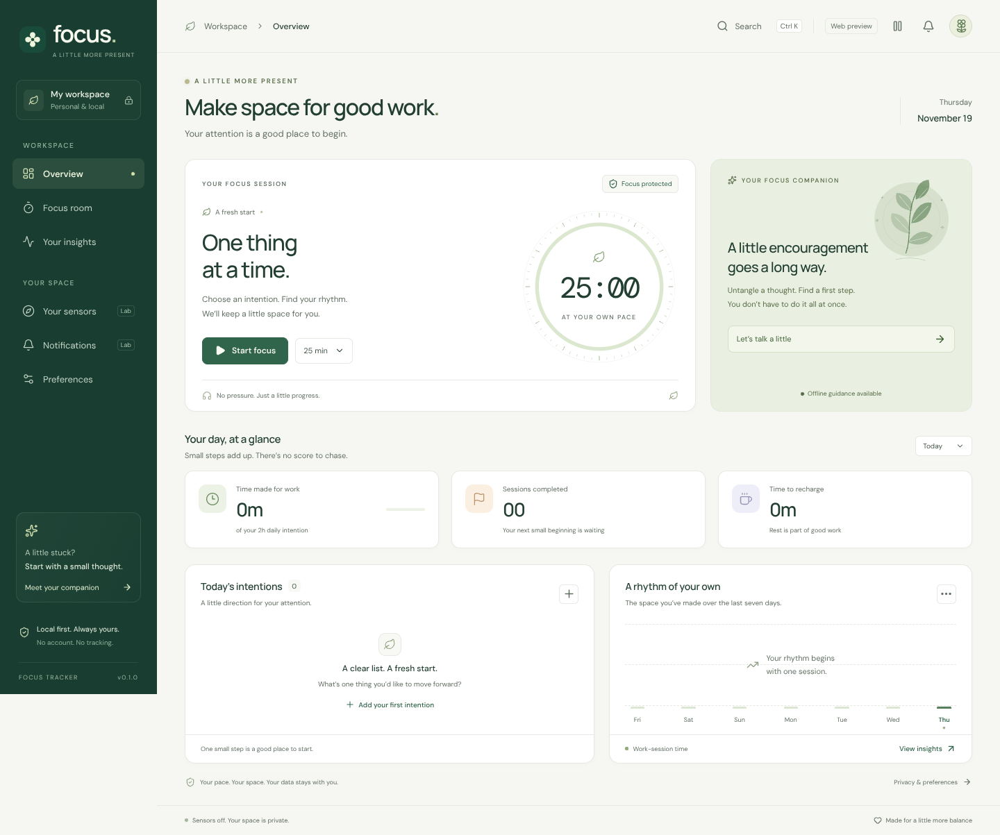

# Focus

**A little more present.** A local-first focus and break companion built with **Rust, Tauri 2, React, and TypeScript**. Linux is the first device-validation target, with Windows and macOS build work kept in the same cycle.



## What works now

This is a working **release candidate for the foundation slice**, not the entire researched product or a validated public production release. The owner selected MIT licensing and signed public distribution; signing/device approval remains gated. See [release preparation](docs/RELEASE.md).

- **Intentions and task sessions** — deep work, reading/learning, and creative work; adjustable durations; pause/resume; early finish; optional breaks.
- **A calm workspace** — focus room, real-data daily summaries and seven-day chart, searchable intentions, voluntary local check-ins, light/dark/system themes, and reduced motion.
- **Respectful rest** — no automatic break, OS lock, or puzzle requirement. An optional three-pair garden game can be left unfinished.
- **Local data controls** — validated preferences, intentions, up to 30 days/500 session summaries, export, deletion, and paused recovery after a restart. Unreadable data is not silently overwritten.
- **Offline companion** — clearly labeled hand-written guidance. Native-only Ollama discovery/chat code is also included, but **has not been exercised against a model server here**.
- **An honest sensor lab** — explicitly opt-in webcam **preview**, plus a **test-pad-only** keyboard-cadence experiment and optional pointer/editing-key counts. Camera lifecycle tests use synthetic streams, not real hardware.
- **Notification rules sandbox** — synthetic examples with explicit reasons, urgent bypass, conservative uncertain-item handling, and a releasable digest. **No real source is connected.**

There is **no global input/idle adapter, webcam inference, mood/boredom/flow detector, real notification suppression, screen-edge overlay, remote API-key provider, autostart, or OS-lock integration**. The app is useful with every sensor and AI option off.

## Run the web preview

Requires **Node 22.12+** and npm; the lockfile pins JavaScript dependencies.

```sh
npm ci
npm run dev
```

Open the URL Vite prints (port **1420**). It binds to `0.0.0.0` for development previews. Browser storage belongs to this origin/profile and is **separate from desktop data**. The preview uses a TypeScript timer adapter; desktop IPC selects the Rust engine. A hosted preview never connects to the viewer’s localhost for AI.

For a production web build:

```sh
npm run build
npm run preview
```

## Run the native app

Install the platform’s [Tauri prerequisites](https://v2.tauri.app/start/prerequisites/), Rust with the pinned toolchain in `rust-toolchain.toml`, and Node. On Debian/Ubuntu, install the required WebKitGTK 4.1/GTK development packages; Windows needs the MSVC build tools and WebView2, and macOS needs the Xcode command-line tools. Other distributions have different package names.

```sh
npm ci
npm run tauri -- dev
```

Build an executable without installer packaging:

```sh
npm run tauri -- build --no-bundle --ci
```

The root Cargo workspace produces `target/release/focus-desktop` (`.exe` on Windows). Installer/signing/notarization validation is a separate release gate. An OS-owned file lock prevents two native processes from editing the same workspace. Browser storage uses an exclusive Web Lock; secondary tabs and runtimes without Web Locks are temporary/read-only. Close the owner and reload a secondary tab to take ownership. No unsafe heartbeat fallback is used.

**Native status:** this sandbox has no GTK/WebKit desktop stack. At commit `40a8870`, Rust workspace tests and clippy passed on Linux, Windows, and macOS; Windows NSIS and universal macOS DMG packaging/uploads succeeded. Linux deb/AppImage packaging succeeded, but its headless smoke stopped at a test-script quoting error after launching the real native window. The follow-up fixes argument encoding, syntax-tests the exact injected scripts, and adds a real close-time storage-failure check. Consult the [branch Actions results](https://github.com/ICBMT/focus-traker/actions?query=branch%3Aarena%2F4326f80b-focus-traker) for the **exact checked-out commit**, rather than treating the earlier run as a green matrix. CI launch/compilation is not GNOME/Wayland, permission, hardware, model, or signed-release validation. See [the implementation record](docs/IMPLEMENTATION.md), [native QA checklist](docs/NATIVE_QA.md), and [release guide](docs/RELEASE.md).

## Local Ollama (optional, native only)

Nothing is discovered, downloaded, or contacted automatically.

1. Install/configure Ollama yourself and choose a model whose license fits your use. This app does not install model weights.
2. Configure the server’s **no-cloud settings** if you require local-only inference; consult the [Ollama FAQ](https://docs.ollama.com/faq). A loopback address and a model name do **not** prove that the server never routes to cloud inference.
3. In **Preferences → AI & companion**, read the routing warning, choose the port (default `11434`), and explicitly discover installed models.
4. Select a model, then open the companion. Each Send is deliberate. Current task text is excluded unless you check the context box. Sensor summaries, camera frames, and history are never supplied to the model.

The Rust client uses numeric loopback only, no proxy/redirects, bounded context/response sizes, a 45-second chat timeout, and one chat request at a time. Known `:cloud` names are excluded; this is **not** independent verification of server routing. Cancel drops the client request; the server may continue generating. There is no remote fallback or credential collection.

The original `qwen2.5-coder:3b` example has Qwen Research License restrictions; do not assume it is unrestricted commercial software. The [research register](docs/RESEARCH.md) distinguishes model-download size from RAM requirements. **16 GB RAM/no dedicated GPU is the user’s reference machine, not a measured minimum or performance guarantee.**

## Privacy and recovery

- No analytics, account, advertising SDK, camera recording, or automatic provider calls.
- Browser: versioned local storage. Desktop: bounded plaintext `workspace-v1.json` in Tauri’s OS app-data directory, with staged replacement and Unix owner-only file/directory permissions in the source implementation. **Not encrypted storage or SQLite yet.**
- An active task/checkpoint can be saved even when summary history is off. Recovery always requires a deliberate action and stays paused; sensors, chat, and tests never restore automatically.
- Edits are debounced by about 300 ms; active checkpoints are approximately every 15 seconds and on phase changes. Native close requests pause/stop optional activity and flush before destroying the window; a failed save keeps it open with explicit Keep open, Retry save & close, and Quit without saving choices. Browser pagehide performs a synchronous final save before releasing ownership. Force-quit, OS termination, an in-flight browser command, or storage failure can still lose recent unsaved edits/time. A gap over 15 seconds pauses rather than credits missing time. The browser adapter can pause when its page is heavily throttled; the native host has an independent Rust tick.
- Sensor summaries/comparison samples, example inboxes, chats, provider choices, and games are volatile. Stopping a test or leaving its page clears the relevant sensor experiment; hiding the page stops capture/testing.
- Exports contain **task text**, preferences, and session summaries—not sensors, model credentials, chat, or the active checkpoint. Protect exported files yourself.
- Delete/reset cannot guarantee forensic erasure from storage, swap, backups, or existing exports. OS disk encryption is recommended for sensitive task names.

The input experiment reports **unknown / similar / changed cadence**, not boredom, mood, attention, or psychological flow. Its thresholds are experimental, and it cannot trigger enforcement. See [the input-rhythm contract](docs/INPUT_RHYTHM.md).

## Checks

```sh
npm run typecheck
npm test
npm run test:release
npm run check:release
npm run format:check
npm run test:e2e
cargo fmt --all -- --check
cargo test -p focus-core --locked
# With native system prerequisites:
cargo test --workspace --locked
```

Browser E2E builds production assets, starts a temporary preview on port `1421`, and closes it when done. Prefer `npx playwright install chromium`; minimal Linux x64 sandboxes can use the bundled dev-only Chromium fallback. Screenshots/test artifacts go under ignored `.cache/e2e/`, never sensor recordings.

Observed on **2026-11-19**: **127 frontend/domain/component tests**, **3 release-integrity gate tests + 3 native-harness tests**, and **17 browser scenarios passed** locally. Rust workspace tests passed remotely on all three OS jobs at `40a8870` (Linux: **19 core + 16 native-host tests**). The browser suite includes **32 automated accessibility scans** over both themes/screens/dialogs, with no reported violations in the selected WCAG A/AA checks, and no third-party HTTP requests or uncaught errors in those scenarios. This is not a complete accessibility/security audit or evidence of native/sensor accuracy. Native-host tests cover storage/locking/export and bounded/cancellable HTTP-mocked Ollama calls; the current three-OS workflow checks follow-up changes for its own exact commit. HTTP mocks are not a live-model benchmark.

## Repository map

```text
src/                  React UI, browser adapter, explicit runtime bridge
crates/focus-core/    deterministic Rust sessions, cadence comparison, data schema
src-tauri/            Tauri host, authorized IPC, native storage, loopback AI
fixtures/             scenarios replayed by Rust and TypeScript tests
tests/                frontend/domain/privacy/lifecycle regression tests
scripts/              production-browser and accessibility checks
docs/                 approved research, target design, actual status, native QA
```

## Approved plan and remaining work

| Document | Purpose |
| --- | --- |
| [Implementation status](docs/IMPLEMENTATION.md) | Actual code, test evidence, limitations, and next gates |
| [Native QA](docs/NATIVE_QA.md) | Linux/Windows/macOS validation checklist and untested hardware cases |
| [Product plan](docs/PLAN.md) | Approved wider experience, priorities, and open decisions |
| [Research register](docs/RESEARCH.md) | R01–R27: platform capabilities, evidence limits, and licensing |
| [Input rhythm](docs/INPUT_RHYTHM.md) | Interaction-style research, privacy constraints, and validation design |
| [Architecture](docs/ARCHITECTURE.md) | Target architecture; includes components not yet implemented |
| [Platform support](docs/PLATFORM_SUPPORT.md) | Researched feasibility, not a claim of tested native support |
| [Privacy and safety](docs/PRIVACY_AND_SAFETY.md) | Standing product requirements and safe fallbacks |
| [Roadmap](docs/ROADMAP.md) | Feasibility gates and remaining milestones |

The app/source is [MIT licensed](LICENSE); dependencies retain their own terms. Build-time npm/Cargo notice inventory and an in-app license viewer are included. Separately bundled system libraries, installer resources, trademark obligations, and model licenses still require distribution review. No signed public release has been published. Signing keys belong in the protected CI environment, never in chat; follow [RELEASE.md](docs/RELEASE.md).
